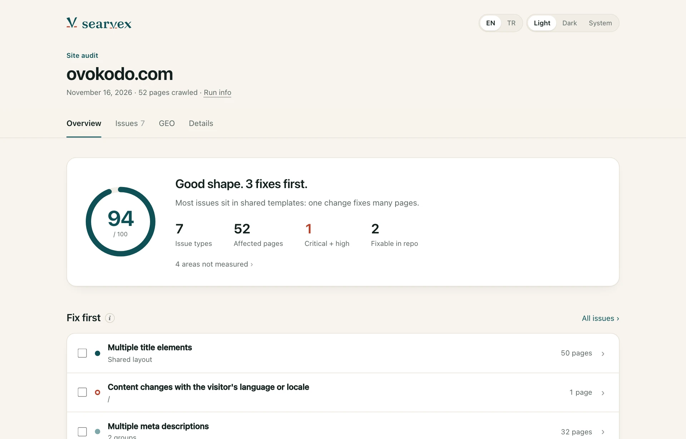
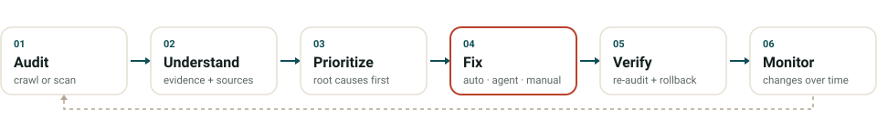
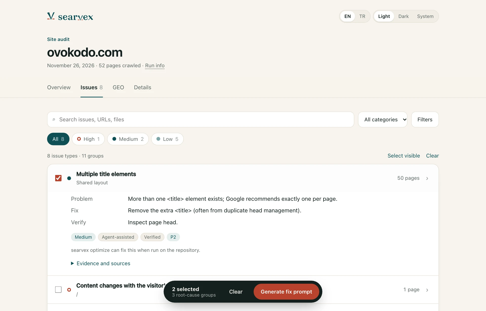
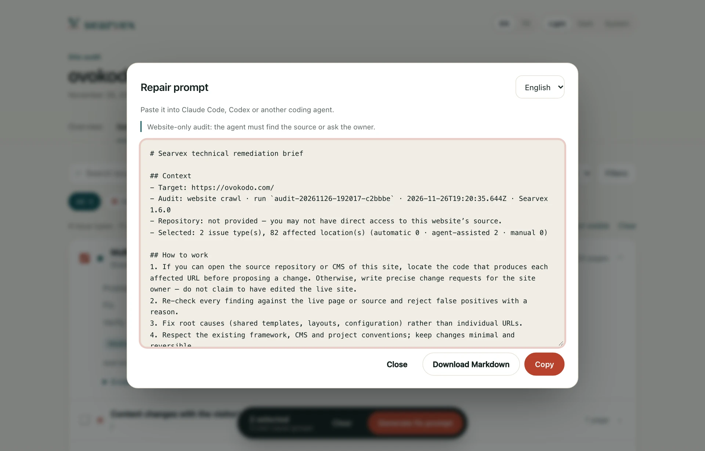
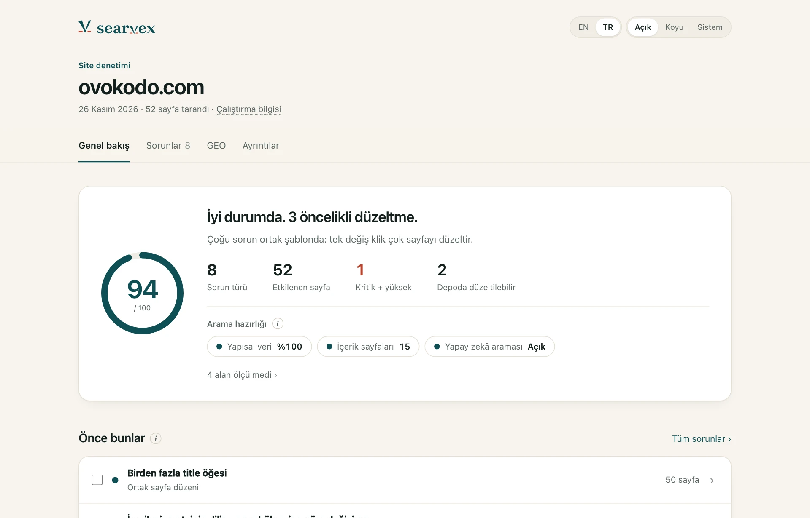
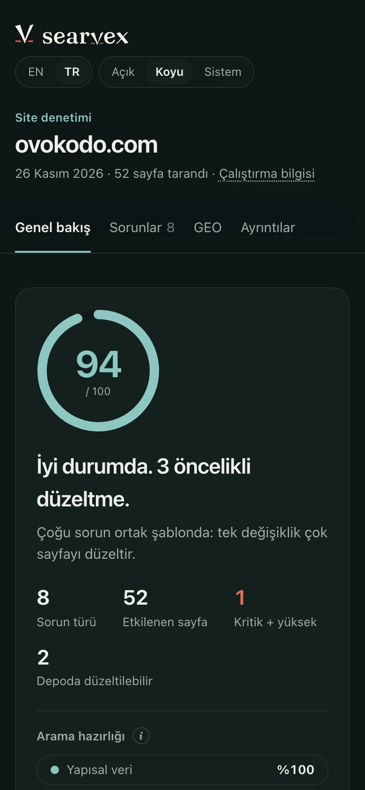

<h1 align="center">
<picture>
  <source media="(prefers-color-scheme: dark)" srcset="https://raw.githubusercontent.com/cihantopac/searvex/main/docs/assets/brand/primary-reversed.svg">
  
</picture>
</h1>

<p align="center"><strong>Understand Search. Fix What Matters.</strong></p>

<p align="center">
Open-source SEO and AI-search auditor for websites and code repositories.<br>
It finds what is wrong, groups it by root cause and fixes the safe parts, with rollback.
</p>

<p align="center">
<a href="https://www.npmjs.com/package/searvex-seo"></a>
<a href="https://github.com/cihantopac/searvex/actions/workflows/ci.yml"></a>
<a href="LICENSE"></a>

</p>

<p align="center">
<picture>
  <source media="(prefers-color-scheme: dark)" srcset="https://raw.githubusercontent.com/cihantopac/searvex/main/docs/assets/dashboard-dark.webp">
  
</picture>
<br><sub>A real report, captured unedited (ovokodo.com, 52 pages). One offline HTML file, no data leaves it.</sub>
</p>

## Quick start

```bash
npm install -g searvex-seo
```

```bash
searvex audit https://example.com --open
```

The same command takes a repository path: `searvex audit ./my-site`. Requires Node.js ≥ 20.10.

**Claude Code plugin**, no npm install needed:

```
/plugin marketplace add cihantopac/searvex
/plugin install searvex@searvex
```

Then run `/searvex <url> [path]`.

<details>
<summary><b>GitHub Actions</b>: findings in code scanning, the job fails at the severity you choose</summary>

```yaml
jobs:
  seo:
    runs-on: ubuntu-latest
    permissions:
      contents: read
      security-events: write # SARIF upload to code scanning
    steps:
      - uses: actions/checkout@v4
      - uses: cihantopac/searvex@v1.6.0
        with:
          target: . # or https://example.com
          fail-on: high
```

Inputs: `target`, `fail-on` (or `none`), `max-pages`, `args` (extra `audit` flags such as `--site-url`), `version`,
`upload-sarif`, `category`. Outputs: `exit-code`, `sarif`, `report`, `run-dir`. The job summary lists the score
and the top issues.

</details>

Full reference: [docs/cli.md](docs/cli.md).

## How it works

<picture>
  <source media="(prefers-color-scheme: dark)" srcset="https://raw.githubusercontent.com/cihantopac/searvex/main/docs/assets/workflow-dark.svg">
  
</picture>

| | |
|---|---|
| **Audit** | A live site (robots.txt-compliant crawl) or a repository: Next.js, Astro, Nuxt, Laravel, WordPress, static HTML. |
| **Understand** | Each finding comes with its evidence, an official source and the date that source was checked. |
| **Prioritize** | One broken layout on 50 pages is one task, not 50. |
| **Fix** | Approve a diff for the safe fixes. Hand the rest to your coding agent with a ready-made prompt. |
| **Verify** | Re-audit after a change. A failed verification rolls the change back. |
| **Monitor** | Regressions show up in the next run and in CI. |

## From findings to fixes

<table>
<tr>
<td width="50%" valign="top">
<picture>
  <source media="(prefers-color-scheme: dark)" srcset="https://raw.githubusercontent.com/cihantopac/searvex/main/docs/assets/issues-dark.webp">
  
</picture>
<p><b>Pick what to fix.</b> Each issue shows the problem, the fix and how to verify it. Evidence and sources are one click away.</p>
</td>
<td width="50%" valign="top">
<picture>
  <source media="(prefers-color-scheme: dark)" srcset="https://raw.githubusercontent.com/cihantopac/searvex/main/docs/assets/prompt-dark.webp">
  
</picture>
<p><b>Hand it to your agent.</b> The repair prompt lists the exact URLs or <code>file:line</code>, with evidence, the fix and the check. It works with Claude Code, Codex or any other agent. Secrets are redacted.</p>
</td>
</tr>
<tr>
<td width="50%" valign="top">

<p><b>English and Türkçe, light and dark.</b> The report follows your system and remembers your choice.</p>
</td>
<td width="50%" valign="top" align="center">

<p><b>Works on a phone.</b></p>
</td>
</tr>
</table>

## What it checks

| | |
|---|---|
| **Technical SEO** | Crawling, indexing, canonicals, redirects, hreflang, metadata, structured data, links, performance and security signals. |
| **GEO / AI search** | AI crawler access by purpose, snippet controls, entity consistency and content clarity. |
| **Repositories** | Findings at `file:line` in framework source. 12 rule types are fixed automatically: dry run → approval → apply → verify → rollback. |
| **Pre-launch builds** | Audit a local or staging build as its public site (`--site-url`). With `--pre-launch`, deliberate pre-launch states go to a launch checklist instead of the score. |
| **Search data** | Optional and read-only: Search Console (API or CSV export) and the Chrome UX Report. Experimental: Bing Webmaster, Lighthouse lab data (`--lab`), Google Analytics 4 and Yandex Webmaster. Without them, clicks and Core Web Vitals show as *not measured* and are never estimated. |
| **Competitors** | Gaps in topic and page-type coverage, labelled as hypotheses. |

<details>
<summary><b>For pipelines and agents</b></summary>

- A read-only MCP server: `searvex mcp`.
- A versioned `report.json` with a published JSON Schema: `searvex schema`.
- Every affected URL per finding.
- Distinct exit codes: `4` when the site is unreachable or blocked by robots.txt, `5` when the run is interrupted.
- `--progress ndjson` and `--max-duration`.
- Limits on hosts and ports.
- `searvex prompt` for repair prompts outside the browser.

</details>

## Evidence, not claims

- **92 rules**, each tied to an official source: 72 verified, 18 heuristic, 2 reported as unmeasurable. Run
  `searvex rules show <id>` to read one.
- **Tested** with unit, integration, browser and end-to-end runs. CI runs on Linux, macOS and Windows with Node 20,
  22 and 24 ([quality report](docs/quality.md)).
- **Validated** on 13 public sites and 9 repositories. Live Search Console and CrUX values matched the official
  exports.
- **Safe by default:**
  - read-only;
  - SSRF protection;
  - robots.txt honoured;
  - secret files never read;
  - every change journaled, with a byte-for-byte rollback.

Searvex never promises rankings, traffic or AI citations. The health score is Searvex's own summary, not a
search-engine metric. See [limitations](docs/limitations.md).

Status: **v1.6.0** ([release notes](docs/release-notes-1.6.0.md), [changelog](CHANGELOG.md)).

## Documentation

[CLI reference](docs/cli.md) · [Architecture](docs/architecture.md) · [Knowledge base](docs/knowledge-base.md) · [Security](docs/security.md) · [Privacy](docs/privacy.md)

## Related tools

Independent open-source tools by the same author:

- [**Relivaro**](https://github.com/cihantopac/relivaro): software reliability, security and release readiness.
- [**Jourilo**](https://github.com/cihantopac/jourilo): UX and conversion engineering in real browser journeys.
- [**Markilo**](https://github.com/cihantopac/markilo): brand identity and vector design for Claude Code. It made the Searvex identity.

## Contributing & license

The most valuable contributions are rules, framework adapters and fixtures. Every rule needs an official source and a
test fixture ([CONTRIBUTING.md](CONTRIBUTING.md)). Report vulnerabilities through [SECURITY.md](SECURITY.md).

[Apache-2.0](LICENSE)
